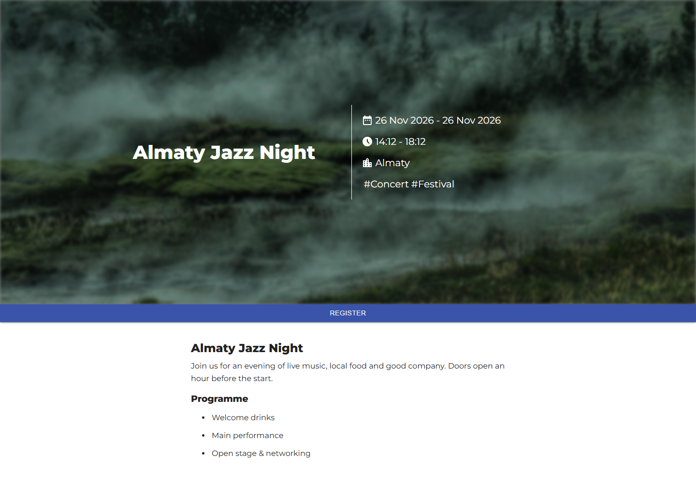
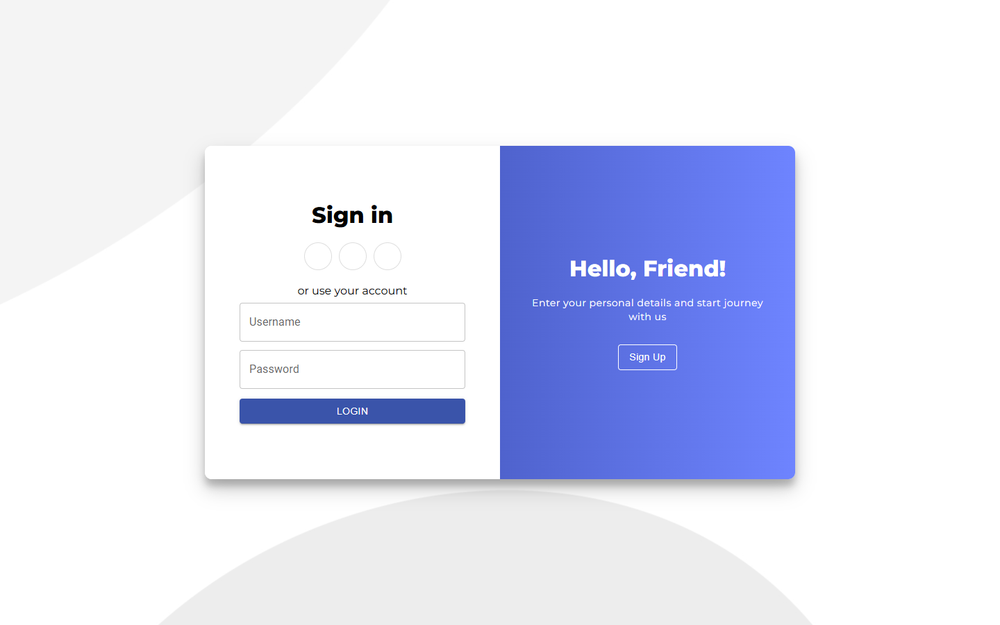
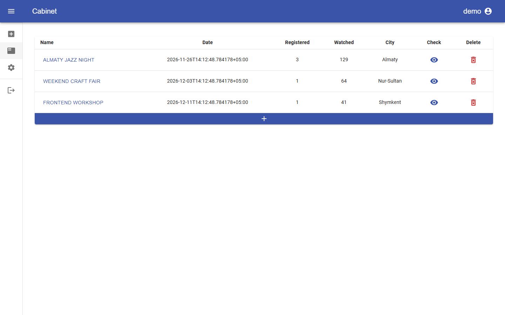
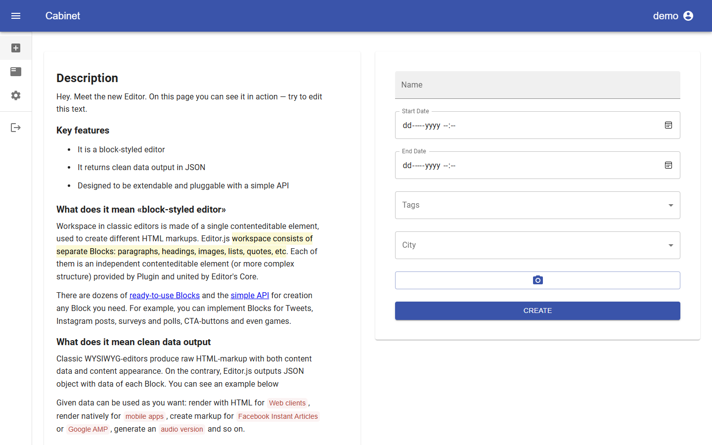
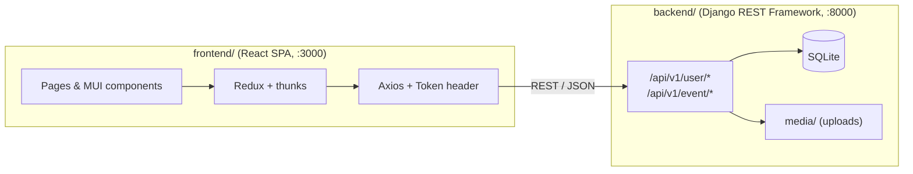

<div align="center">

# 🎟 Eventer

**A web app for creating and publishing your own events.**

Organizers create events with a rich-text editor in their personal cabinet.
Guests open the event page and sign up in one click.


[](LICENSE)



</div>

---

## ✨ Features

**For organizers**

- 🔐 Sign up and sign in with token authentication
- 📝 Create events with a name, start and end date, tags, city and cover image
- 🧱 Write rich descriptions in [Editor.js](https://editorjs.io/): headings,
  lists, tables, code, embeds, images and galleries
- 💾 Save your own description template as the editor's default
- 📊 See all your events in a table with registration and view counts
- 🗑 Delete events (they are hidden, not erased)

**For guests**

- 🌄 Event page with a blurred cover, date, time, city and tags
- ✍️ Sign up for an event with name, email and contacts
- 👁 Every page visit is counted

## 📸 Screenshots

| Sign in / Sign up | My events |
| :---: | :---: |
|  |  |
| **Create an event** | **Event page** |
|  |  |

## 🏗 Architecture



## 🚀 Getting started

### Requirements

- Python 3.10+
- Node.js 16+

### Backend

```bash
cd backend
python -m venv venv
source venv/bin/activate        # Windows: venv\Scripts\activate
pip install -r requirements.txt Pillow
python manage.py migrate
python manage.py runserver      # → http://localhost:8000
```

> [!NOTE]
> `Pillow` is needed for image fields and isn't listed in `requirements.txt` yet.

### Frontend

```bash
cd frontend
npm install --legacy-peer-deps
npm start                       # → http://localhost:3000
```

The API address is set in
[`frontend/src/services/settings.tsx`](frontend/src/services/settings.tsx)
(`http://localhost:8000/api/v1/` by default).

| Script          | Description                              |
| --------------- | ---------------------------------------- |
| `npm start`     | Webpack dev server with hot reload       |
| `npm run build` | Production build into `frontend/dist/`   |
| `npm run dev`   | Development build without the server     |

## 🔌 REST API

Base URL: `/api/v1/`. Send authenticated requests with the header
`Authorization: Token <token>`.

<details>
<summary><b>User</b>: <code>/user/…</code></summary>

| Method | Endpoint                 | Description                                           |
| ------ | ------------------------ | ----------------------------------------------------- |
| `POST` | `/user/register`         | Sign up: `username`, `email`, `password`              |
| `POST` | `/user/login`            | Sign in. Returns `{ token }`                          |
| `GET`  | `/user/identify/<token>` | Get the user profile for a token                      |
| `GET`  | `/user/editor`           | 🔒 Get the user's default editor template             |
| `POST` | `/user/editor`           | 🔒 Save the default editor template                   |

</details>

<details>
<summary><b>Event</b>: <code>/event/…</code></summary>

| Method   | Endpoint                 | Description                                                 |
| -------- | ------------------------ | ----------------------------------------------------------- |
| `GET`    | `/event/all`             | All active events                                           |
| `GET`    | `/event/get?id=<uuid>`   | One event (adds one to its view count)                      |
| `GET`    | `/event/user`            | 🔒 Events of the current user                               |
| `POST`   | `/event/create`          | 🔒 Create an event (multipart, dates as Unix timestamps)    |
| `POST`   | `/event/image`           | Upload an image for Editor.js                               |
| `PATCH`  | `/event/register/<id>`   | Sign up for an event: `name`, `email`, `contacts`           |
| `PATCH`  | `/event/like/<id>`       | 🔒 Like an event (not your own, once per user)              |
| `DELETE` | `/event/delete/<id>`     | 🔒 Hide your event                                          |
| `GET`    | `/event/special/cities`  | List of allowed cities                                      |
| `GET`    | `/event/special/tags`    | List of allowed tags                                        |

</details>

Allowed **cities** and **tags** are set in
[`backend/core/constant.py`](backend/core/constant.py), and the server checks
new events against them.

## 🗂 Project structure

```text
eventer/
├── backend/                 # Django project
│   ├── core/                # settings, root urls, constants (cities, tags)
│   ├── user/                # custom User model, auth & editor settings API
│   └── event/               # Event model, serializers, validators, API
├── frontend/                # React + TypeScript SPA (custom Webpack config)
│   └── src/
│       ├── pages/           # auth, cabinet (+ fragments), event, home, 404
│       ├── components/      # events table, notes, Editor.js wrappers, dialogs
│       ├── redux/           # user state, thunks
│       ├── services/        # Axios API clients
│       └── swal/            # SweetAlert2 dialogs
└── design/                  # Figma mockups & mind map
```

## 📄 License

[MIT](LICENSE) © Eduard Lik
